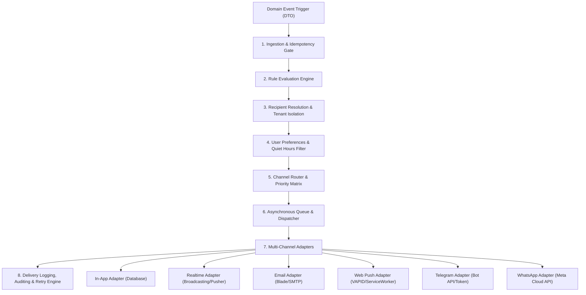

# NEXOVANT — STAGE 11 IMPLEMENTATION PLAN
## Centralized Notification & Communication Intelligence Engine

**Document Version:** 1.0.0  
**Phase:** Stage 11  
**Project:** Nexovant — Intelligence Beyond Headlines  
**Author:** Principal Platform Architect  
**Date:** November 16, 2026  
**Status:** Approved for Implementation  

---

## 1. Executive Summary & Architectural Vision

Nexovant's intelligence operations require an authoritative, reliable, and real-time communication fabric. In preceding stages (Phases 1–10), various platform subsystems independently generated events:
- **Phase 5 & 6:** Story clustering, breaking news discovery, and deep fact verification.
- **Phase 7A & 7C:** Grounded RAG synthesis, subscriber workspace watchlists, and monitored entity updates.
- **Phase 7D & Stage 9/10:** Subscription billing, automated renewal, payment method failures, regional checkout events.
- **Phase 7E:** Multi-tenant enterprise organizations, invitation lifecycles, and team research sharing.

**Stage 11 consolidates these disparate events into a single, centralized, event-driven Notification & Communication Intelligence Engine.** Rather than fragmenting communication across controllers, mailables, or ad-hoc jobs, all domain events pass through an 8-stage pipeline that guarantees:
1. **Zero Message Loss & Exactly-Once Semantics:** Idempotency keys prevent duplicate notifications for the same event trigger.
2. **Channel Orchestration:** Multi-channel routing across In-App, Real-Time (Broadcasting), Email, Web Push (VAPID), Telegram Bot API, and Meta WhatsApp Business API.
3. **Strict Tenant & Entitlement Boundaries:** Organization notifications never leak across enterprise boundaries; confidential intelligence alerts respect subscriber entitlement tiers.
4. **Subscriber Autonomy & Quiet Hours:** Granular preference controls across categories and channels, respecting local timezones and quiet hour pauses with digest batching.
5. **Auditable Delivery & Administration:** Complete delivery logs with retry controls and administrative broadcast mechanisms.

---

## 2. Notification Engine 8-Stage Pipeline Architecture



### 2.1 Pipeline Stages Explained

1. **Stage 1: Ingestion & Idempotency Gate:**
   - Ingests a strongly typed `NotificationEventDTO`.
   - Generates or checks an `idempotency_key` (e.g., `event_type:entity_id:recipient_id:hash`). If an identical event was processed within the deduplication window (default 1 hour, configurable per rule), subsequent triggers are safely discarded.
2. **Stage 2: Rule Evaluation Engine:**
   - Evaluates active entries from `notification_rules`. Matches on `event_type` and `source_module`.
   - Injects default priority (`low`, `medium`, `high`, `urgent`), default channel lists, and digest schedules.
3. **Stage 3: Recipient Resolution & Tenant Isolation:**
   - Resolves target user IDs (individual subscriber, organization members, or role-based platform groups).
   - Enforces strict multi-tenant boundaries: if an event is tagged with `organization_id`, only active members of that specific organization can receive the notification.
4. **Stage 4: User Preferences & Quiet Hours Filter:**
   - Queries `subscriber_notification_preferences` for each recipient.
   - Evaluates channel enablement and category filters (`breaking_news`, `watchlist_updates`, `research_ready`, `billing_alerts`, `organization_updates`, `system_announcements`).
   - Checks recipient's timezone and configured `quiet_hours`. If quiet hours are active, non-urgent notifications are routed into a pending digest queue rather than delivered immediately. Critical/urgent alerts (security, payment failure, high-priority system announcements) bypass quiet hours.
5. **Stage 5: Channel Router & Priority Matrix:**
   - Determines the active delivery channels for each recipient.
   - For transactional and security notifications, In-App and Email are guaranteed.
   - For urgent breaking intelligence, Web Push and Telegram are prioritized alongside In-App.
6. **Stage 6: Asynchronous Queue & Dispatcher:**
   - Dispatches queued jobs (`SendChannelNotificationJob`) with exponential backoff retry policies.
7. **Stage 7: Channel Adapters:**
   - Decoupled adapters execute protocol-specific payloads:
     - `InAppChannelAdapter`: Persists to the `notifications` table.
     - `BroadcastChannelAdapter`: Emits `NotificationDispatched` over private WebSockets channel (`private-user.{id}`).
     - `EmailChannelAdapter`: Dispatches branded, responsive HTML template `NexovantNotificationMail`.
     - `WebPushChannelAdapter`: Signs payload with VAPID keys and dispatches to registered device endpoints.
     - `TelegramChannelAdapter`: Sends Markdown-formatted alerts to verified chat IDs via Telegram Bot API.
     - `WhatsAppChannelAdapter`: Evaluates WhatsApp Business Cloud API readiness; logs pending onboarding status gracefully.
8. **Stage 8: Delivery Logging, Auditing & Retry Engine:**
   - Writes granular audit records to `notification_delivery_logs`.
   - Tracks delivery state: `delivered`, `sent`, `failed`, `unconfigured_channel`, `suppressed_quiet_hours`.
   - Enables administrative retry with exponential backoff and payload inspection.

---

## 3. Database Schema Extensions

### 3.1 Migration Strategy (`0001_01_01_000104_expand_notifications_and_create_communication_tables.php`)

```sql
-- 1. Extend notifications table
ALTER TABLE notifications ADD COLUMN priority VARCHAR(20) DEFAULT 'medium' AFTER is_read;
ALTER TABLE notifications ADD COLUMN source_module VARCHAR(50) NULL AFTER priority;
ALTER TABLE notifications ADD COLUMN organization_id CHAR(36) NULL AFTER source_module;
ALTER TABLE notifications ADD COLUMN idempotency_key VARCHAR(128) NULL AFTER organization_id;
ALTER TABLE notifications ADD COLUMN metadata JSON NULL AFTER idempotency_key;
CREATE INDEX idx_notifications_user_unread ON notifications (user_id, is_read);
CREATE INDEX idx_notifications_idempotency ON notifications (idempotency_key);
CREATE INDEX idx_notifications_org ON notifications (organization_id);

-- 2. Create web_push_subscriptions table
CREATE TABLE web_push_subscriptions (
    id CHAR(36) PRIMARY KEY,
    user_id CHAR(36) NOT NULL,
    endpoint TEXT NOT NULL,
    public_key VARCHAR(255) NOT NULL,
    auth_token VARCHAR(255) NOT NULL,
    user_agent VARCHAR(255) NULL,
    is_active BOOLEAN DEFAULT TRUE,
    created_at TIMESTAMP NULL,
    updated_at TIMESTAMP NULL,
    FOREIGN KEY (user_id) REFERENCES users(id) ON DELETE CASCADE
);
CREATE INDEX idx_push_user_active ON web_push_subscriptions (user_id, is_active);

-- 3. Create telegram_link_tokens table
CREATE TABLE telegram_link_tokens (
    id CHAR(36) PRIMARY KEY,
    user_id CHAR(36) NOT NULL,
    token VARCHAR(64) UNIQUE NOT NULL,
    expires_at TIMESTAMP NOT NULL,
    used_at TIMESTAMP NULL,
    created_at TIMESTAMP NULL,
    updated_at TIMESTAMP NULL,
    FOREIGN KEY (user_id) REFERENCES users(id) ON DELETE CASCADE
);
CREATE INDEX idx_telegram_tokens_lookup ON telegram_link_tokens (token, expires_at);

-- 4. Create notification_rules table
CREATE TABLE notification_rules (
    id CHAR(36) PRIMARY KEY,
    name VARCHAR(100) NOT NULL,
    event_type VARCHAR(100) UNIQUE NOT NULL,
    source_module VARCHAR(50) NOT NULL,
    priority VARCHAR(20) DEFAULT 'medium',
    channels JSON NOT NULL,
    template_name VARCHAR(100) NULL,
    frequency VARCHAR(20) DEFAULT 'realtime', -- realtime, hourly_digest, daily_digest, weekly_digest
    is_active BOOLEAN DEFAULT TRUE,
    conditions JSON NULL,
    created_at TIMESTAMP NULL,
    updated_at TIMESTAMP NULL
);
```

---

## 4. Multi-Channel Delivery Matrix

| Channel | Protocol / Provider | Auth & Security Mechanism | Fallback / Failure Strategy |
| :--- | :--- | :--- | :--- |
| **In-App** | Database persistence (`notifications`) | Sanctum user session / bearer token | Persistent storage; retry on DB lock |
| **Realtime** | WebSocket / Laravel Broadcasting | Private channel auth `private-user.{id}` | Seamless 15s polling fallback in frontend |
| **Email** | SMTP / Mailgun / SES / Blade | Signed unsubscribe link, SPF, DKIM | Retry up to 3x with exponential backoff |
| **Web Push** | Web Push RFC 8291 / 8292 | VAPID key pair (public/private signing) | Auto-delete invalid endpoints on 410 Gone |
| **Telegram** | Telegram Bot API | One-time expiring HMAC token linking | Delivery log records Telegram error status |
| **WhatsApp** | Meta WhatsApp Cloud API | System Access Token + Verified WABA ID | Evaluated; logs `pending_merchant_onboarding` |

---

## 5. API Specification

### 5.1 Subscriber Workspace Endpoints (`/api/v1/workspace/notifications` & `/api/v1/notifications/*`)
- `GET /api/v1/workspace/notifications`: Filterable by category, unread status, priority. Paginated.
- `PATCH /api/v1/workspace/notifications/{id}/read`: Mark single notification read.
- `POST /api/v1/workspace/notifications/read-all`: Mark all or category notifications read.
- `DELETE /api/v1/workspace/notifications/{id}`: Delete or archive notification.
- `GET /api/v1/workspace/notifications/preferences`: Get subscriber notification preferences.
- `PUT /api/v1/workspace/notifications/preferences`: Update channels, categories, quiet hours.
- `GET /api/v1/notifications/push/vapid-key`: Retrieve public VAPID key for browser subscription.
- `POST /api/v1/notifications/push/subscribe`: Store browser PushSubscription keys.
- `POST /api/v1/notifications/push/unsubscribe`: Revoke push subscription.
- `POST /api/v1/notifications/telegram/link-token`: Generate secure 15-minute bot link token.
- `POST /api/v1/notifications/telegram/verify`: Verify bot hook or token with chat ID.
- `POST /api/v1/notifications/telegram/disconnect`: Remove linked Telegram account.
- `POST /api/v1/notifications/telegram/test`: Dispatch verification message to connected Telegram.

### 5.2 Administrator Control Center Endpoints (`/api/v1/admin/notifications/*`)
- `GET /api/v1/admin/notifications/metrics`: Real-time analytics (total sent, failed, channel distribution, retry queue).
- `GET /api/v1/admin/notifications/logs`: Paginated delivery logs with status and error filtering.
- `POST /api/v1/admin/notifications/retry/{logId}`: Re-trigger delivery for failed attempts.
- `POST /api/v1/admin/notifications/broadcast`: Dispatch administrative announcements with targeting (all, plan, organization) and preview capability.
- `GET /api/v1/admin/notifications/rules`: List configurable system notification rules.
- `PUT /api/v1/admin/notifications/rules/{id}`: Update rule priority, channels, and digest settings.

---

## 6. Frontend User Interface Architecture

1. **Header Realtime Notification Drawer (`NotificationDrawer.vue`):**
   - Bell icon with unread count badge in `AppHeader.vue`.
   - Slide-over drawer with quick unread filtering, category icons, timestamps, and 1-click "Mark All Read".
   - Seamless deep linking to `/notifications` or relevant entity/publication.
2. **Central Subscriber Notification Center (`NotificationsView.vue` at `/notifications` and `/workspace/notifications`):**
   - Top metrics overview (Total, Unread, Urgent, Intelligence updates).
   - Category navigation tabs: `All`, `Unread`, `Intelligence`, `Account & Billing`, `Organization`, `System`.
   - Rich notification cards with priority pill, source badge, direct action button, and dismiss action.
   - Connected Channels status panel (Push notification status, Telegram connection card with copyable command).
3. **Notification Preferences Tab (`SubscriberPreferencesView.vue` / Notification Settings):**
   - Toggle matrix for In-App, Email, Push, Telegram, WhatsApp across categories.
   - Quiet Hours selector with timezone picker and digest delivery frequency (Realtime, Daily Summary, Weekly Digest).
4. **Admin Notification Control Center (`AdminNotificationsView.vue`):**
   - Key delivery KPIs (24h Volume, Delivery Rate %, Error Rate %, Channel Split).
   - Delivery log inspector with filter by status (`failed`, `delivered`), search by user/recipient, and instant retry button.
   - Broadcast announcement composer with preview, markdown formatting, priority selection, and target audience selector.
   - Notification rule configurator.

---

## 7. Implementation Roadmap & Milestones

- **Milestone 1:** Migration & Database Schema Extension.
- **Milestone 2:** Core Notification Engine DTO, Pipeline & Channel Adapters.
- **Milestone 3:** Digest Command & Broadcasting Integration.
- **Milestone 4:** Backend API Controllers & Route Registration.
- **Milestone 5:** Frontend UI Integration (`AppHeader`, `NotificationDrawer`, `NotificationsView`, settings).
- **Milestone 6:** Automated Feature Test Suite (`CentralizedNotificationEngineStage11Test.php`).
- **Milestone 7:** Real-Browser E2E Verification via Chrome DevTools MCP.
- **Milestone 8:** Final Architectural & Audit Documentation Delivery.
