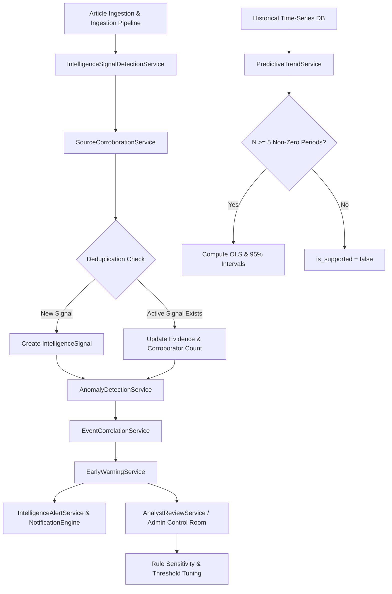

# Nexovant Stage 13 — Architecture Specification
## Intelligence Automation, Predictive Monitoring & Early-Warning System

**Document Version:** 1.0.0  
**Status:** Production Ready  
**Component:** Automated Intelligence & Surveillance Engine  

---

## 1. Architectural Overview

Nexovant Stage 13 establishes an automated intelligence surveillance, change detection, and early-warning framework. It transforms the platform from a reactive news aggregator into an active intelligence platform that continuously evaluates incoming disclosures, extracts verifiable signals, measures statistical anomalies against moving baselines, calculates evidence-backed early warnings, and extrapolates multi-week trend forecasts.

---

## 2. Component Structure

### 2.1 Backend Services Layer (`app/Services/Automation/`)
- **`IntelligenceSignalDetectionService`**: Evaluates ingested items across 12 distinct signal classifications, deduplicates against 7-day rolling windows, and records independent vs syndicated evidence.
- **`AnomalyDetectionService`**: Calculates moving averages, sample standard deviations, and deviation z-scores ($Z = \frac{X - \mu}{\sigma}$). Enforces minimum sample size guardrails ($N \ge 5$).
- **`EventCorrelationService`**: Matches co-occurring developments across entities and roots. Enforces strict governance rule: `is_causation_claimed = false`.
- **`EarlyWarningService`**: Evaluates multi-factor thresholds and constructs transparent 9-point audit explanations with lifecycle state transitions.
- **`PredictiveTrendService`**: Fits Ordinary Least Squares (OLS) regression models over historical multi-week observation windows, computes MAE, RMSE, and $R^2$, and constructs 95% prediction intervals.
- **`IntelligenceImpactAssessmentService`**: Constructs structured 8-dimensional operational impact matrices.
- **`AnalystReviewService`**: Manages human-in-the-loop review queue, records false-positive audit marks, and calibrates heuristic thresholds.
- **`IntelligenceAlertService`**: Integrates early warnings and high-severity signals into the Stage 11 `NotificationEngine`.
- **`AutomatedIntelligenceReportService`**: Compiles 12-section structured intelligence summaries with traceable citations, exporting to Markdown and JSON schema.
- **`IntelligenceMonitoringService`**: Orchestrates scheduled and on-demand surveillance scans.

### 2.2 Artisan Automation Commands
- `php artisan discovery:evaluate-saved-searches`: Evaluates subscriber saved searches and dispatches multi-channel alerts.
- `php artisan intelligence:evaluate-monitors`: Evaluates automated intelligence rules and flags anomalies across recently ingested reporting.

---

## 3. Data Schema & Relationships

### Database Tables Created
1. `intelligence_signals`: Primary signal records with severity, review status, and multi-tenant isolation.
2. `signal_evidences`: Supporting and contradictory evidence records, tracking source credibility and syndication markers.
3. `anomaly_observations`: Statistical baseline and observed deviation logs with data sufficiency flags.
4. `correlated_events`: Entity/topic co-occurrence mappings with alternative hypotheses and `is_causation_claimed = false`.
5. `early_warnings`: Active warnings with 4-level severity rankings, factor breakdowns, and 9-point explanations.
6. `early_warning_histories`: Immutable transition history with analyst notes and user attribution.
7. `trend_forecasts`: Time-series projection models with OLS parameters, intervals, and data sufficiency flags.
8. `intelligence_impact_assessments`: 8-dimensional operational impact evaluations.
9. `analyst_reviews`: Human reviewer decisions, false-positive markers, and sensitivity adjustments.
10. `automated_intelligence_reports`: 12-section intelligence summaries with Markdown/JSON export caches.
11. `intelligence_detection_rules`: Configurable heuristic and credibility gating rules for surveillance.
