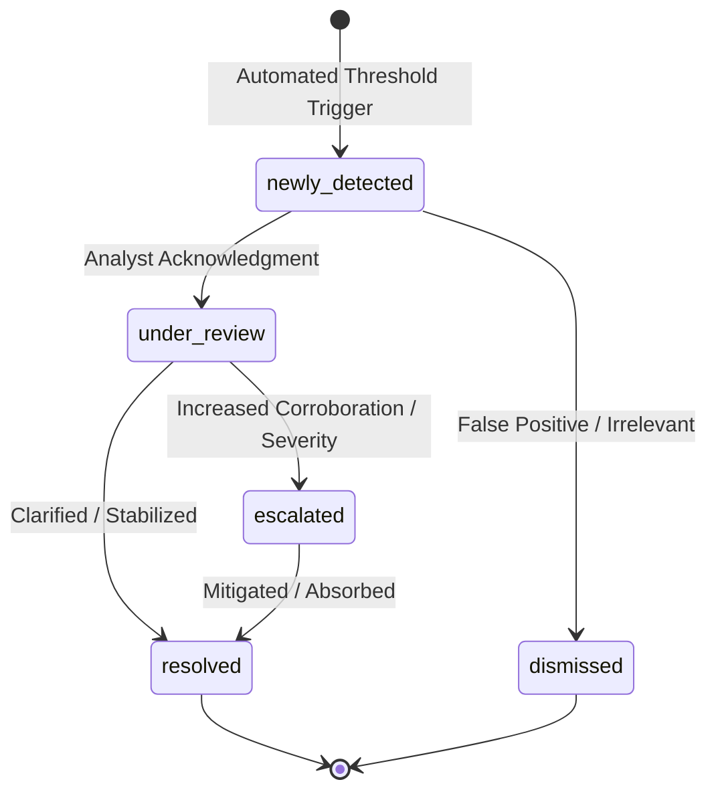

# Nexovant Stage 13 — Early-Warning Methodology
## Severity Tiers, Factor Breakdown & 9-Point Audit Framework

**Document Version:** 1.0.0  
**Status:** Production Ready  

---

## 1. Early-Warning Framework

The Early-Warning Engine synthesizes signals, statistical anomalies, and event correlations to detect high-impact shifts before they manifest as critical supply disruptions or market shocks.

---

## 2. 4 Warning Severity Tiers

1. **`Informational`**:
   - Single-source disclosure or low-impact operational update.
   - Low baseline deviation. Logged for longitudinal baseline monitoring.
2. **`Watch`**:
   - Corroborated signal with moderate deviation from historical baseline.
   - Requires monitoring across secondary watchpoints.
3. **`Elevated`**:
   - High-credibility multi-source reporting concerning core supply-chain or regulatory factors.
   - Significant baseline deviation or rapid reporting velocity acceleration.
4. **`Critical`**:
   - Multi-source verified breaking development involving tier-1 entities, formal sanctions, or material manufacturing disruption.
   - Triggers real-time notification dispatch via Stage 11 `NotificationEngine`.

---

## 3. Factor Breakdown Structure

Each warning calculates an 8-dimensional factor audit:
1. `independent_sources`: Verifiable independent publishing outlets (syndicated reprints excluded).
2. `credibility_score`: Normalized source credibility average ($0.0$ to $1.0$).
3. `verification_status`: Status from Stage 12 corroborated claims (`verified`, `confirmed`, `single_source`, `disputed`).
4. `rate_of_change`: Empirical reporting velocity acceleration over baseline window.
5. `persistence`: Duration since first observation.
6. `geographic_relevance`: Jurisdictional scope (e.g., GLOBAL, US, EU, ASIA-PACIFIC).
7. `baseline_deviation`: Parametric $Z$-score classification.
8. `potential_impact`: Structural disruption rating (`moderate`, `high`, `critical`).

---

## 4. The 9-Point Transparent Explanation

To avoid opaque "AI black-box" alerts, every early warning is accompanied by a standardized 9-part explanatory disclosure:

1. **What Changed:** Factual restatement of the primary development.
2. **When First Observed:** ISO 8601 timestamp of earliest verified source.
3. **Supporting Sources:** Explicit list of primary and independent corroborating publishers.
4. **What Makes It Unusual:** Concrete statistical or structural divergence from expected baseline.
5. **What Is Verified:** Confirmed empirical facts extracted from primary filings.
6. **What Remains Uncertain:** Developing, speculative, or unconfirmed dimensions.
7. **Why Considered Important:** Systematic supply chain or commercial dependency rationale.
8. **Additional Information Needed:** Explicit data requirements (e.g., SEC 10-Q filing, government gazette publication).
9. **Recommended Watch Points:** Actionable secondary developments to monitor (e.g., earnings calls, supplier pricing shifts, docket updates).

---

## 5. Lifecycle State Machine

Early warnings follow a strict audit-logged lifecycle:

Every transition generates an immutable record in `early_warning_histories` tracking:
- `previous_status`
- `new_status`
- `transition_reason`
- `user_id` (analyst who authorized transition)
- `created_at`
