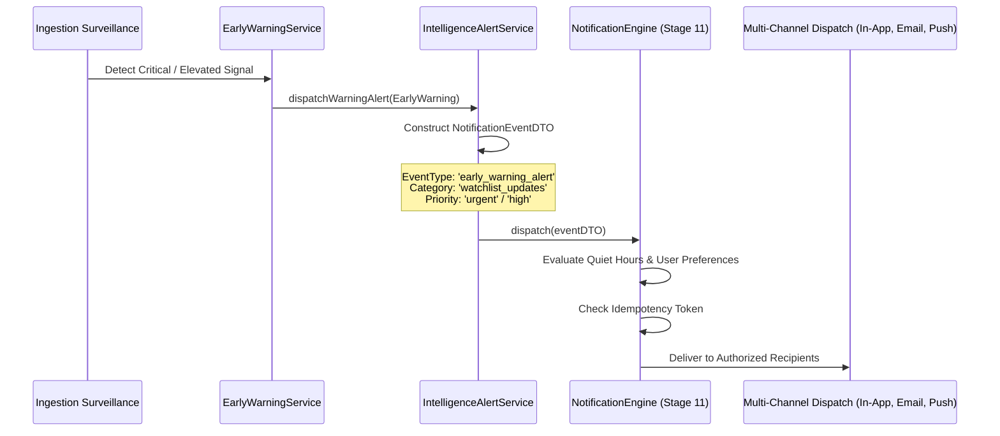

# Nexovant Stage 13 — Notification Engine Integration
## Centralized Dispatch, Multi-Channel Routing & Idempotency

**Document Version:** 1.0.0  
**Status:** Production Ready  

---

## 1. Overview

Stage 13 does not build isolated alerting or notification silos. All automated early warnings and critical signals route directly through the centralized Stage 11 `NotificationEngine`.

---

## 2. Event Dispatch Architecture

---

## 3. Data Transfer Object (DTO) Mapping

`IntelligenceAlertService` constructs a standardized `NotificationEventDTO`:
- `eventType`: `'early_warning_alert'` or `'critical_signal_alert'`
- `category`: `'watchlist_updates'` (mapped to Stage 11 notification category matrix)
- `priority`:
  - `urgent`: For `critical` warnings or `breaking` technology disruptions.
  - `high`: For `elevated` warnings.
  - `medium`: For `watch` warnings.
- `title`: `"[Early Warning] {$warning->title}"`
- `summary`: Primary `what_changed` explanation excerpt.
- `actionUrl`: `"/workspace/monitors"`
- `organizationId`: Warning's `organization_id` (enforcing strict tenant boundaries).
- `metadata`:
  - `warning_id`: UUID
  - `warning_level`: `critical` | `elevated` | `watch`
  - `signal_id`: UUID
  - `independent_sources`: Count

---

## 4. Idempotency Gate

To prevent notification floods when multiple articles arrive regarding the same breaking event:
- Idempotency key generated as:
  $$\text{IdempotencyKey} = \text{hash}('sha256', \text{"warning-alert-{$warning->id}-{$warning->status}"})$$
- `NotificationEngine` evaluates the key against active delivery logs, ensuring each warning level/status transition is dispatched exactly once.
