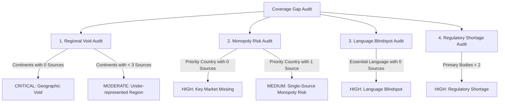

# NEXOVANT — STAGE 14
## Automated Coverage Gap Analysis & Detection

### 1. The Coverage Blindspot Problem

Without proactive gap analysis, an intelligence platform risks silent blindspots:
1. Complete geographic absence in critical geopolitical regions.
2. Reliance on a single source in key economies, creating vulnerability to state censorship, editorial bias, or downtime.
3. Language blindspots where content cannot be ingested in native tongues.
4. Total dependence on secondary news reporting in the absence of primary regulatory gazettes.

### 2. Gap Detection Engine: `CoverageGapDetectionService`

The gap detection service executes automated audits across four dimensions:



### 3. Severity & Action Schema

Every detected gap returns an actionable diagnostic object:

```json
{
  "gap_type": "single_source_monopoly",
  "severity": "medium",
  "category": "Country",
  "target": "BD",
  "title": "Single-Source Monopoly Risk: Bangladesh (BD)",
  "description": "Only 1 active source exists for Bangladesh. Risk of editorial bias and lack of independent corroboration.",
  "recommended_action": "Onboard at least one additional independent corroborating source."
}
```

### 4. API Endpoint

`GET /api/v1/admin/sources/coverage-gaps` delivers:
- `total_gaps`: Total count of active blindspots.
- `critical_count`, `high_count`, `moderate_count`: Breakdown by severity.
- `gaps`: Array of identified gaps with remediation actions.
