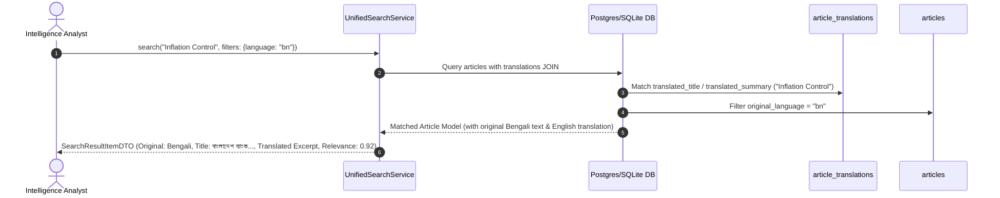

# NEXOVANT — STAGE 14
## Cross-Language Intelligence Discovery & Search

### 1. Unified Search Multilingual Pipeline

`UnifiedSearchService` has been extended to provide native cross-language intelligence retrieval. Analysts searching in English or any supported platform language can discover and correlate developments published in native non-English outlets.



### 2. Search Query Execution

In `UnifiedSearchService::searchArticles`:
1. **Title & Content Querying:**
   ```php
   $qb->where(function (Builder $q) use ($query) {
       $q->where('title', 'like', "%{$query}%")
         ->orWhere('content_normalized', 'like', "%{$query}%")
         ->orWhere('content_raw', 'like', "%{$query}%")
         ->orWhereHas('translations', function (Builder $tq) use ($query) {
             $tq->where('translated_title', 'like', "%{$query}%")
                ->orWhere('translated_summary', 'like', "%{$query}%")
                ->orWhere('translated_content', 'like', "%{$query}%");
         });
   });
   ```
2. **Language Filtering:**
   ```php
   if (!empty($filters['language'])) {
       $lang = strtolower((string) $filters['language']);
       $qb->where(function (Builder $lq) use ($lang) {
           $lq->where('original_language', $lang)
              ->orWhere('detected_language', $lang)
              ->orWhereHas('source', fn(Builder $sq) => $sq->where('language', $lang))
              ->orWhereHas('translations', fn(Builder $tq) => $tq->where('target_language', $lang));
       });
   }
   ```
3. **Response Payload:**
   `SearchResultItemDTO` returns:
   - `original_language`: ISO code of native article.
   - `detected_language`: Verified detected language.
   - `translations`: Array of available target language translations with summary excerpts.
   - `relevance_explanation`: Explicit notice of multilingual match (e.g. `Multilingual translation match ('en') with 95% source credibility`).
