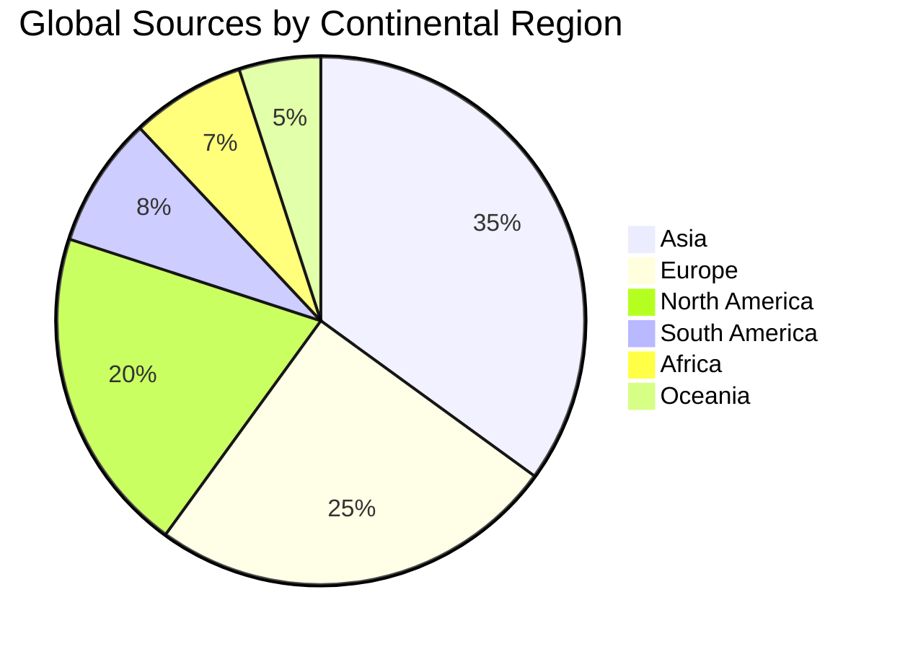

# NEXOVANT — STAGE 14
## Global Geographic Coverage Architecture

### 1. Separation of Coverage vs Event Location

Nexovant maintains a strict distinction between:
- **Source Publisher Jurisdiction (`NewsSource::country_code` and `NewsSource::continent`):** The legal jurisdiction and geographic base of the publishing entity (e.g. Bangladesh for Bangladesh Bank, United States for the SEC or Federal Reserve).
- **Article Event Geographic Scope (`Article::geographic_scope`):** The geopolitical territory where reported events or economic developments physically take place.

### 2. Continental & Regional Aggregations

`GeographicCoverageService` aggregates real-time intelligence coverage across 6 continental clusters:

### 3. Coverage Analytics API: `GET /api/v1/admin/sources/coverage-analytics`

Returns structured metrics:
- `total_continents`: Number of active continental zones represented.
- `total_countries_covered`: Count of sovereign nations with active intelligence sources.
- `continents`: Array containing `continent`, `total_sources`, and `active_sources`.
- `countries`: Array detailing `country_code`, `continent`, `active_sources`, and `article_count`.
- `languages`: Language diversity distribution.
- `global_summary`: Total sources, active sources, total indexed articles across the entire platform.

### 4. Country Drilldown API

`GeographicCoverageService::getCountryCoverage(string $countryCode)` provides complete operational transparency into any sovereign jurisdiction:
- Total and active source counts for that nation.
- Total indexed articles originating from that country.
- Distribution across source types (regulatory, RSS, academic, wire).
- List of native languages indexed.
- Full source catalog with individual health and reliability ratings.
