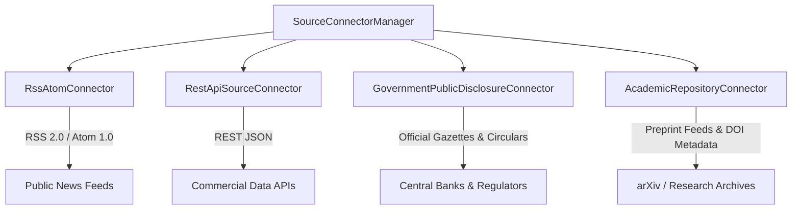

# NEXOVANT — STAGE 14
## Ingestion Connectors & Connector Management

### 1. Connector Interface Contract

Every ingestion protocol implements `SourceConnectorInterface`:

```php
interface SourceConnectorInterface
{
    public function supports(NewsSource $source): bool;
    public function validateEndpoint(string $endpoint): bool;
    public function testConnection(NewsSource $source): array;
    public function fetch(NewsSource $source, array $options = []): array;
}
```

### 2. Implemented Connectors



#### 2.1 RssAtomConnector
- Supports `rss`, `atom`, `wire`, `news_feed`.
- Uses `FeedCollectorService` with conditional caching (`ETag`, `If-Modified-Since`).
- Parses `<channel><item>` and `<feed><entry>` structures with entity decoding and tag stripping.
- Safe XML entity loader (`LIBXML_NONET | LIBXML_NOERROR | LIBXML_NOWARNING`) prevents XXE and quadratic expansion attacks.

#### 2.2 RestApiSourceConnector
- Supports `rest_api`, `news_api`.
- Supports Bearer Token, API Key (Header or Query), and Basic HTTP Authentication.
- Dynamic envelope unwrapping: automatically detects array wrappers (`data`, `articles`, `results`, `items`, `posts`, `rows`).
- Extracts canonical URLs, authors, published dates, and custom taxonomy tags.

#### 2.3 GovernmentPublicDisclosureConnector
- Supports `regulatory`, `government`, `official_disclosure`, `public_gazette`.
- Formulates verified public reporting attribution (`Official Public Notice (Publisher)`).
- Normalizes regulatory filing identifiers and official directive citations.

#### 2.4 AcademicRepositoryConnector
- Supports `academic`, `academic_repository`, `preprint`, `research_archive`.
- Ingests scholarly feeds from arXiv, Crossref, and university repositories.
- Extracts DOI, author registries, quantitative finance categories, and abstracts.

### 3. SourceConnectorManager

`SourceConnectorManager` resolves the appropriate connector by priority:
1. `GovernmentPublicDisclosureConnector` (regulatory / official)
2. `AcademicRepositoryConnector` (scholarly / preprint)
3. `RestApiSourceConnector` (JSON API)
4. `RssAtomConnector` (default feed handler)

Provides unified `testSource(NewsSource $source)` returning standard latency and sample item structures.
