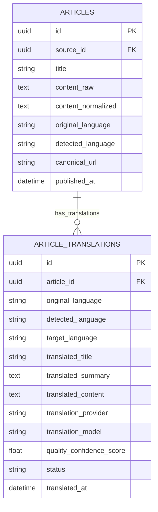

# NEXOVANT — STAGE 14
## Multilingual Ingestion & Intelligence Processing

### 1. Ingestion Principles: Absolute Immutability of Original Text

Nexovant treats all ingested news content as legal and factual evidence. 
- Original content in `articles.title`, `articles.content_raw`, and `articles.content_normalized` is **strictly immutable**.
- System NEVER replaces or mutates original non-English text with English translation.
- All translations are stored in the dedicated `article_translations` table, linked by UUID to the parent `Article`.

### 2. Language Detection Service

`LanguageDetectionService` identifies language through a multi-pass heuristic:
1. **Unicode Script Detection:**
   - Bengali script: Unicode range `\x{0980}-\x{09FF}`. Confidence $> 0.95$ when script matches $> 10\%$ of non-whitespace characters.
   - Arabic script: Unicode range `\x{0600}-\x{06FF}`.
   - Cyrillic script: Unicode range `\x{0400}-\x{04FF}`.
2. **Frequency Analysis for Latin Languages:**
   - Tokenizes words and compares against lexical stopword frequency dictionaries for French (`le`, `la`, `des`, `du`, `dans`, `pour`), German (`der`, `die`, `das`, `und`, `nicht`), Spanish (`el`, `la`, `los`, `de`, `por`), and English (`the`, `and`, `of`, `to`, `is`).
3. Output: `array{language: string, confidence: float, is_reliable: bool}`.

### 3. Translation Engine & Entity Preservation

`TranslationService` translates foreign language content while enforcing:
- **Entity Preservation:** Named entities (e.g. `Bangladesh Bank`, `Chittagong Port Authority`), executive names, dates, currency symbols, and quoted statements are preserved verbatim.
- **Provider Routing:** Uses `AIRouterService` with low temperature ($0.1$) for high factual fidelity, with lexical fallback for offline/test environments.
- **Deduplication / Caching:** Queries existing `(article_id, target_language)` records to prevent duplicate translation calls.
