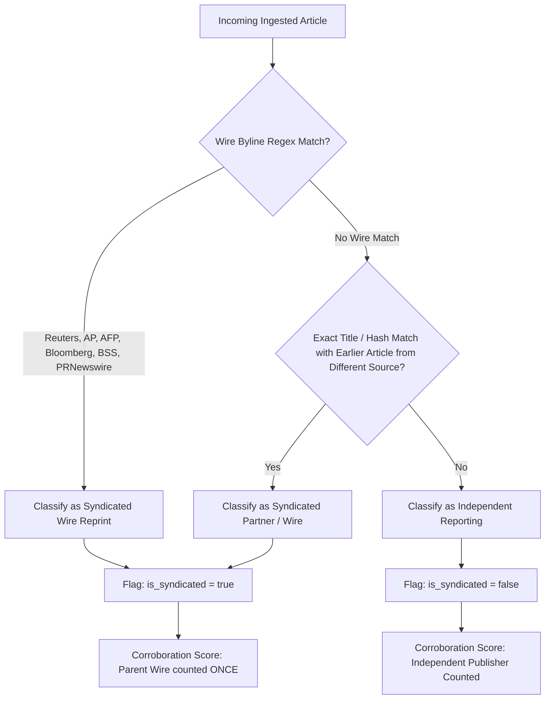

# NEXOVANT — STAGE 14
## Source Diversity & Independence Safeguards

### 1. Echo Chamber Prevention & Syndication Detection

A major flaw in naive news aggregators is confusing volume with corroboration. If 50 regional newspapers reprint the exact same syndicated wire story from Reuters, AP, or BSS, the raw article count is 50, but the independent corroboration count is **1**. 

Allowing wire reprints to artificially inflate event corroboration scores compromises intelligence veracity. Nexovant implements strict source diversity safeguards via `SourceDiversityService`.

### 2. Independence Metrics Formula

When calculating the diversity of an intelligence cluster or story, `SourceDiversityService::calculateIndependenceMetrics()` evaluates:

$$\text{Diversity Index} = \min\left(1.0, \frac{N_{\text{unique domains}}}{N_{\text{raw articles}}} + 0.20 \times \frac{N_{\text{primary sources}}}{N_{\text{raw articles}}}\right)$$

Key properties:
- If 10 articles come from 1 wire agency across 10 syndication mirrors, $\frac{1}{10} = 0.10$ diversity index.
- If 5 articles come from 5 distinct publishing entities with 2 primary regulatory filings, the diversity index achieves a maximum $1.0$.

### 3. System Diversity Telemetry: `GET /api/v1/admin/sources/diversity-metrics`

Provides platform-wide transparency:
- `total_sources`: Total registered sources.
- `unique_canonical_domains`: Unique independent parent organizations.
- `primary_source_ratio`: Percentage of platform feeds representing official/primary documentation.
- `sample_recent_diversity`: Sampling recent articles to report active wire networks (Reuters, Associated Press, BSS, Bloomberg, PR Newswire) and system-wide diversity index.
