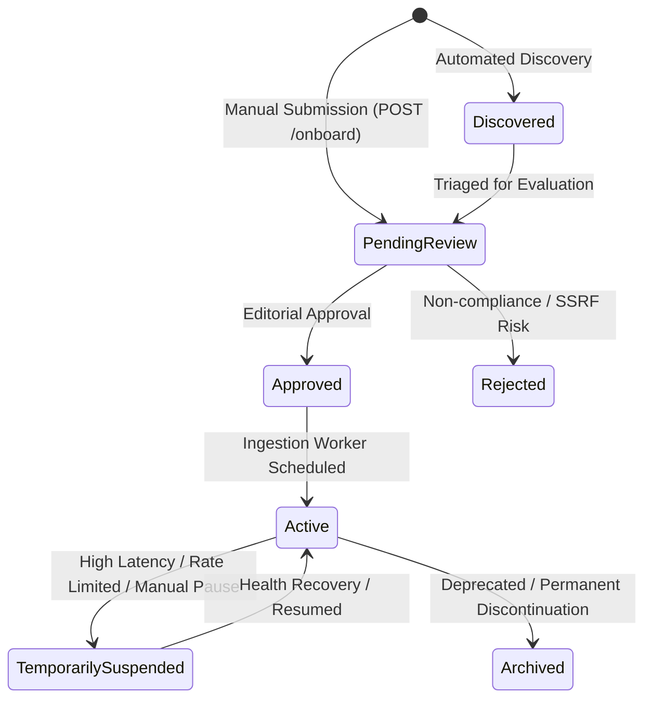

# NEXOVANT — STAGE 14
## Source Onboarding & Editorial Governance Workflow

### 1. Workflow Architecture

To prevent poisoned ingestion pipelines, SSRF vulnerabilities, and low-credibility aggregator spam, Nexovant enforces an editorial governance gate through `SourceOnboardingService`. Sources progress through defined state machines prior to receiving collection workers.

### 2. Mandatory Verification Gates

Before any source transitions to `approved` or `active`:
1. **Endpoint Safety (SSRF Defense):**
   - Protocol must be strictly `http` or `https`.
   - Host must not resolve to `localhost`, `.local`, `.internal`, RFC1918 private ranges (`10.0.0.0/8`, `172.16.0.0/12`, `192.168.0.0/16`), link-local/cloud metadata (`169.254.169.254`), zero-networks, or carrier-grade NAT.
   - Redirect chains are verified at each hop with redirection depth limited to 3.
2. **Canonical Domain Normalization:**
   - URL host is parsed and normalized (removing `www.` prefixes and sub-paths) to identify the parent publishing entity.
3. **Pre-flight Live Connection Probe:**
   - The appropriate connector executes a test fetch (limit 3 items).
   - Measures exact HTTP round-trip latency in milliseconds.
   - Confirms valid XML/JSON structure, extracting sample headlines and published timestamps.
4. **Attribution & Terms Compliance:**
   - Mandatory attribution requirements must be recorded (e.g. `Reporting by Bangladesh Bank`).
   - Terms of use / robots compliance URL recorded.
5. **Credential Encryption:**
   - Any sensitive bearer token or API key is encrypted using Laravel's `Crypt::encryptString()` before hitting the database.

### 3. Editorial Queue Management

- `GET /api/v1/admin/sources/onboarding-queue`: Lists sources requiring editorial review.
- `POST /api/v1/admin/sources/{id}/approve`: Approves and activates the source. Appends audit log and timestamped reviewer note to `onboarding_notes`.
- `POST /api/v1/admin/sources/{id}/reject`: Rejects source with mandatory reason string.
- `POST /api/v1/admin/sources/{id}/suspend`: Suspends active polling without deleting historical articles.
