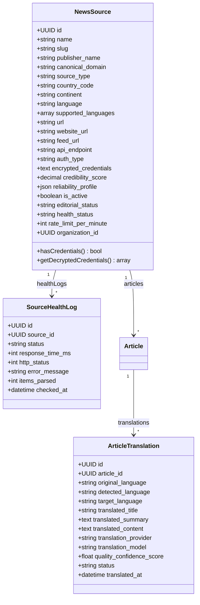

# NEXOVANT — STAGE 14
## Global Source Network & Centralized Source Registry

### 1. Architectural Overview

Nexovant's Centralized Source Registry extends the core `NewsSource` model into a globally distributed, multi-modal intelligence ingestion catalog. It acts as the canonical system of record for all external data providers, managing metadata, credentials, rate limits, editorial states, and jurisdiction classifications.

### 2. Supported Source Types & Classification

1. **RSS 2.0 & Atom 1.0 Feeds (`rss`, `atom`, `wire`):**
   - High-velocity syndicated news and publisher updates.
   - Polled with `ETag` and `Last-Modified` conditional HTTP headers to avoid redundant payload transfer.
2. **REST APIs (`rest_api`, `news_api`):**
   - Structured JSON API endpoints.
   - Configurable bearer tokens, API keys, basic authentication, and custom pagination parameters.
3. **Government & Regulatory Disclosures (`regulatory`, `official_disclosure`, `public_gazette`):**
   - Official central bank portals, securities commissions (SEC, BSEC, ESMA), and ministerial gazettes.
   - Primary attribution extraction and legal citation indexing.
4. **Academic & Preprint Archives (`academic`, `academic_repository`, `preprint`):**
   - Scholarly literature (arXiv, Crossref, OpenAlex) indexing quantitative finance and macroeconomic models.
   - DOI extraction, authors metadata, and abstract parsing.
5. **Private Organization Feeds (`organization_id !== null`):**
   - Proprietary intelligence feeds isolated per tenant with strict cryptographic access boundaries.

### 3. Database Schema Extensions

Migration `0001_01_01_000108_create_source_network_and_multilingual_tables.php` applied the following structural enhancements to `news_sources`:
- `canonical_domain`: Clean domain root (e.g., `bb.org.bd` stripped of sub-paths/www) for syndication and parent publisher deduplication.
- `country_code`: 2-letter ISO country jurisdiction code.
- `continent`: Continental geographical cluster (`Asia`, `Europe`, `North America`, `South America`, `Africa`, `Oceania`, `Global`).
- `supported_languages`: JSON array of supported publisher languages.
- `api_endpoint`: Secondary API endpoint for JSON ingestion.
- `auth_type`: Ingestion authentication method (`none`, `bearer`, `api_key`, `basic`).
- `encrypted_credentials`: AES-256 encrypted payload storing tokens and keys.
- `editorial_status`: Governance lifecycle stage (`discovered`, `pending_review`, `approved`, `active`, `temporarily_suspended`, `rejected`, `archived`).
- `onboarding_notes`: Governance audit trail recording reviewer IDs and decisions.
- `attribution_requirements`: Mandatory public reporting citation notice.
- `terms_of_use_url`: Public terms of service and robots policy link.
- `reliability_profile`: Real-time composite scoring JSON object.
- `organization_id`: Nullable foreign UUID scoping source access to specific enterprise tenants.

### 4. API Endpoints

- `GET /api/v1/admin/sources`: Paginated catalog with multi-type, country, language, status, and tenant filters.
- `POST /api/v1/admin/sources`: Legacy registration endpoint aliased to onboarding.
- `PUT /api/v1/admin/sources/{id}`: Modify source configuration, rate limits, and attribution.
- `PUT /api/v1/admin/sources/{id}/toggle`: Instant activation or pause toggle.
- `DELETE /api/v1/admin/sources/{id}`: Soft/hard removal of collection endpoint.
