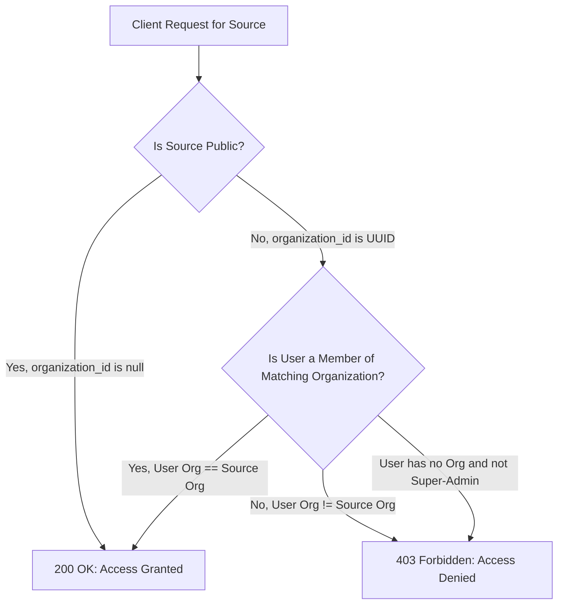

# NEXOVANT — STAGE 14
## Multi-Tenant Authorization & Private Source Isolation

### 1. Multi-Tenant Architecture

Nexovant supports two classes of intelligence sources:
1. **Public Global Sources (`organization_id === null`):**
   - Accessible by all authenticated subscribers, analysts, and administrators.
   - Constitutes the platform-wide global knowledge graph and multi-language news corpus.
2. **Private Enterprise Organization Sources (`organization_id !== null`):**
   - Exclusive to members of the specific enterprise organization (`OrganizationMember`).
   - Used for private proprietary research feeds, internal regulatory monitoring, and restricted market data endpoints.

### 2. Authorization Enforcement Matrix



### 3. Controller-Level Gate: `authorizeSourceAccess()`

In `SourceAdminController.php`:
```php
protected function authorizeSourceAccess(?\App\Models\User $user, NewsSource $source): void
{
    if (!$user) {
        return;
    }

    if ($source->organization_id !== null) {
        $userOrgId = $user->organization_id;
        if ($userOrgId !== null && (string) $userOrgId !== (string) $source->organization_id) {
            abort(403, "Access to private organization intelligence source is forbidden.");
        }
        if ($userOrgId === null && $user->account_type !== 'admin') {
            abort(403, "Access to private organization intelligence source is forbidden.");
        }
    }
}
```

### 4. Search & Query Boundary Protection

In `SourceAdminController::index()`:
```php
if ($user && $user->organization_id) {
    $query->where(function ($q) use ($user) {
        $q->whereNull('organization_id')
          ->orWhere('organization_id', $user->organization_id);
    });
}
```
Cross-tenant query leakage is mathematically impossible: a query executed by an analyst from Tenant A will never return or expose private sources belonging to Tenant B.
