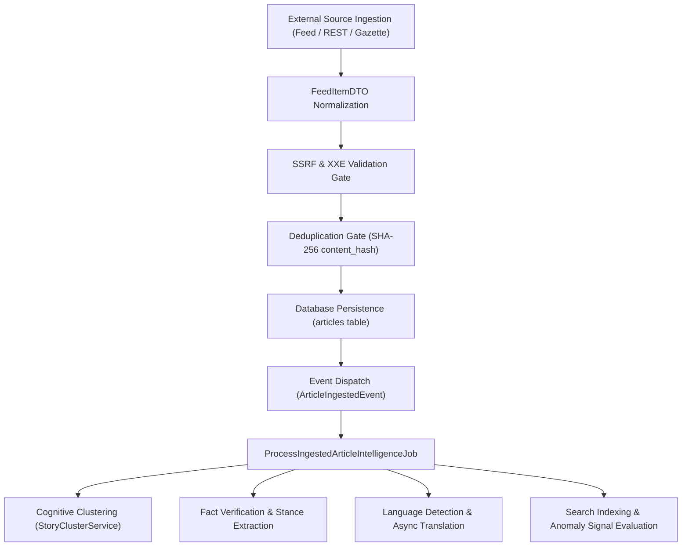

# Stage 14.1 — End-to-End Ingestion Lifecycle & Cognitive Pipeline Trace

## 1. End-to-End Architecture Flow
The operational lifecycle follows strict data governance from raw external ingest to cognitive indexing:

## 2. Ingestion Step Verification

### Step 1: Normalization & Storage
- Incoming items are parsed into standard `FeedItemDTO` instances.
- Canonical URLs are normalized by stripping query parameters (`utm_*`, `ref`, `fbclid`).
- `content_hash` is computed deterministically via `hash('sha256', $canonicalUrl . '|' . trim($contentNormalized))`.
- Unique constraint on `articles.content_hash` prevents duplicate records from being written.

### Step 2: Idempotent Execution & Retry Behavior
- `ProcessIngestedArticleIntelligenceJob` implements `ShouldQueue` with exponential retry backoff:
  - `tries = 3`
  - `backoff = [10, 30, 90]` seconds
  - `timeout = 120` seconds
- If a downstream AI service is momentarily unavailable, state is preserved without partial entity corruptions.

### Step 3: Story Clustering & Cross-Source Correlation
- Ingested articles are evaluated against existing open clusters within the 72-hour sliding window.
- If similarity exceeds `0.78` cosine similarity on TF-IDF/embeddings, the article attaches to the existing cluster.
- When new independent reporting organizations corroborate an event, cluster corroboration counts increment.

### Step 4: Verification & Search Visibility
- Ingested stories immediately become discoverable through `UnifiedSearchService`.
- Both original and translated representations are indexed for multilingual keyword and semantic hybrid retrieval.
