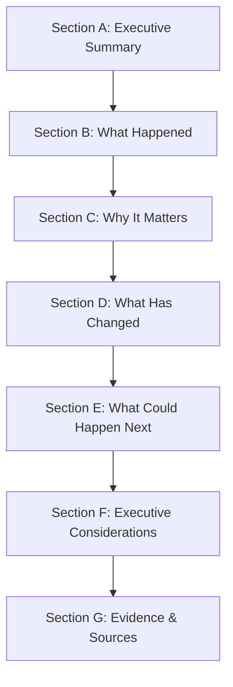

# Stage 15 — Executive Intelligence Briefing Engine

## 1. Executive Purpose & Scope

The Executive Briefing Engine is designed to distill complex multi-source intelligence streams into concise, structured 7-section briefings for C-suite leaders and board members.

Every briefing strictly distinguishes verified factual developments from forward-looking scenarios and discloses sources with full citation traceability.

---

## 2. The 7-Section Architecture

Each briefing produced by `ExecutiveBriefingService` consists of 7 defined sections:

### Section A: Executive Summary
- 3–4 sentence high-level synthesis of macro shifts, signal velocity, and immediate executive posture.
- Quantifies sources consulted, time horizon, and geographic scope.

### Section B: What Happened (Chronological & Attributed)
- Sequence of verified events within the reporting period (24 hours, 7 days, 30 days).
- Each item contains:
  - Timestamp & date.
  - Entities involved.
  - Primary source name & verification tier.
  - Permanent citation marker (e.g., `[1]`, `[2]`).

### Section C: Why It Matters (Multi-Dimensional Implications)
- **Industry Implications**: Market structure and capacity shifts.
- **Business Implications**: Margin sensitivities and commercial terms.
- **Operational Implications**: Supply chain, logistics, and vendor dependencies.
- **Competitive Implications**: Competitor capital expenditures and strategic alignments.
- **Regulatory & Geopolitical Implications**: Sanctions, subsidies, compliance, and trade policy.

### Section D: What Has Changed (Delta Analysis)
- Baseline status before the reporting period.
- New verified development.
- Magnitude and direction of change (+/- signal velocity).
- Evidence strength rating (`High`, `Medium`, `Low`).

### Section E: What Could Happen Next (Scenario Outlook)
- Triad or dual trajectories:
  - **Baseline Scenario**: Most probable operational continuation.
  - **Divergent Scenario**: Disruption or accelerated catalyst path.
- Clear trigger thresholds and expected time horizons (30–90 days, 90–180 days).

### Section F: Executive Considerations
- **Decisions Requiring Immediate Attention**: Board or committee governance items.
- **Potential Actions**: Mitigations, dual-sourcing, liquidity reviews.
- **Expected Benefits & Trade-offs**: Risk-benefit balance.
- **Information Still Needed**: Intelligence gaps requiring dedicated monitoring.

### Section G: Evidence & Verified Sources
- Complete bibliographic table of all referenced sources.
- Links to original canonical disclosures, publisher trust tiers, and publication timestamps.

---

## 3. Workflow & Approval Lifecycle

1. **Synthesis**: Scheduled or ad-hoc generation via `ExecutiveBriefingService::generateBriefing()`.
2. **Review & Revision**: Analysts edit narrative, adjust parameters, creating new version records in `executive_briefing_versions`.
3. **Approval**: Human reviewer marks `status = 'approved'` and `review_status = 'approved'`.
4. **Export**: Full report exportable to structured Markdown (`.md`) or standardized JSON (`.json`).
