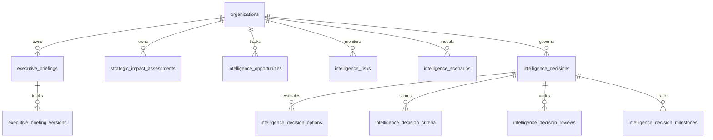

# Stage 15 — Database Design & Schema Specification

## 1. Schema Architecture Overview

Stage 15 introduces 11 tables managed via migration `0001_01_01_000109_create_stage15_executive_decision_support_tables.php`. All tables use UUID/ULID primary keys, full indexing on lookups and foreign keys, JSON casts for semi-structured evidence structures, and strict `organization_id` foreign key isolation.

---

## 2. Table Specifications

### 2.1 `executive_briefings`
- `id` (uuid, primary key)
- `organization_id` (uuid, nullable, indexed, references `organizations`)
- `author_id` (uuid, references `users`)
- `title` (string, 255)
- `slug` (string, 255, unique)
- `period_type` (enum: `daily`, `weekly`, `monthly`, `custom`)
- `coverage_start`, `coverage_end` (timestamp)
- `industry_scope`, `geographic_scope` (string, nullable)
- `status` (enum: `draft`, `generated`, `reviewed`, `approved`, `published`)
- `review_status` (enum: `pending`, `approved`, `rejected`)
- `reviewed_by` (uuid, references `users`, nullable)
- `reviewed_at` (timestamp, nullable)
- `executive_summary` (text)
- `what_happened` (json)
- `why_it_matters` (json)
- `what_has_changed` (json)
- `what_could_happen_next` (json)
- `executive_considerations` (json)
- `evidence_and_sources` (json)
- `citations` (json)
- `version` (integer, default 1)
- `timestamps`

### 2.2 `executive_briefing_versions`
- `id` (uuid, primary key)
- `briefing_id` (uuid, indexed, references `executive_briefings`)
- `version_number` (integer)
- `title` (string)
- `content_payload` (json)
- `change_summary` (text, nullable)
- `created_by` (uuid, references `users`)
- `timestamps`

### 2.3 `strategic_impact_assessments`
- `id` (uuid, primary key)
- `organization_id` (uuid, nullable, indexed)
- `author_id` (uuid, references `users`)
- `title`, `slug` (string)
- `dimension` (enum across 10 dimensions)
- `affected_entities` (json)
- `affected_industry_or_market`, `geographic_scope` (string, nullable)
- `potential_direction` (enum: `positive`, `negative`, `neutral`, `bifurcated`)
- `estimated_magnitude` (enum: `low`, `moderate`, `severe`, `transformative`)
- `time_horizon` (enum: `immediate_30d`, `near_term_90d`, `medium_term_12m`, `long_term_24m_plus`)
- `supporting_evidence`, `contradictory_evidence` (json)
- `assumptions` (json)
- `confidence_level` (enum: `low`, `medium`, `high`)
- `uncertainty_explanation`, `methodology_explanation` (text, nullable)
- `status` (string, default `active`)
- `timestamps`

### 2.4 `intelligence_opportunities` & `intelligence_risks`
- Key tracking fields for 9 opportunity types and 9 risk categories.
- Tracks `likelihood_score` (0-100), `severity` / `potential_impact`, `time_horizon`, `confidence`, `supporting_evidence` (json), and `recommended_monitoring_indicators` (json).

### 2.5 `intelligence_scenarios`
- Stores scenario triad branches (`optimistic`, `baseline`, `adverse`, `alternative`).
- Stores `initial_conditions`, `key_assumptions` (json), `trigger_events` (json), `opportunities` (json), `risks` (json), `indicators_to_monitor` (json), and `uncertainty_rating` (`low`, `medium`, `high`, `extreme`).
- Flags `is_custom` and `is_archived`.

### 2.6 `intelligence_decisions` & Child Tables
- `intelligence_decisions`: Governs the business question, deadline, recorded human decision statement, approval status (`pending_approval`, `approved`, `rejected`), approver ID, and approval timestamp.
- `intelligence_decision_options`: Strategic choices evaluated under each decision. Stores trade-offs (`advantages`, `disadvantages`, `risks`), scores, and `is_selected` boolean.
- `intelligence_decision_criteria`: Weighted evaluation criteria.
- `intelligence_decision_milestones`: Observable milestones (`pending`, `in_progress`, `completed`, `delayed`).
- `intelligence_decision_reviews`: Multi-stakeholder and post-decision retrospective audit trail.
