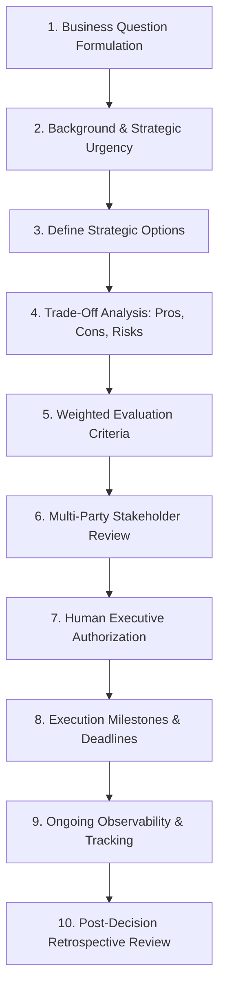

# Stage 15 — Structured Decision Support & Governance

## 1. Executive Purpose

The Decision Support System bridges the gap between intelligence consumption and executive action. It provides a structured framework for evaluating complex strategic choices while enforcing strict corporate governance.

---

## 2. The Non-Negotiable Human Authorization Policy

```
┌────────────────────────────────────────────────────────────────────────┐
│               NON-NEGOTIABLE HUMAN AUTHORIZATION POLICY                │
│                                                                        │
│  Nexovant AI assists, scores options, and models trade-offs.           │
│  AI NEVER approves, signs, or executes business decisions autonomously.│
│                                                                        │
│  Every decision must be reviewed and authorized by an authenticated,   │
│  authorized human executive with a recorded timestamp and audit entry. │
└────────────────────────────────────────────────────────────────────────┘
```

- When AI generates options, the decision status remains `draft` or `in_review`.
- The `approval_status` field remains `pending_approval`.
- Only a POST call to `/api/v1/executive/decisions/{id}/approve` from an authorized user can record the selection and transition status to `decision_recorded`.

---

## 3. The 10-Step Decision Process



### 1. Business Question Formulation
Defines the concrete decision required (e.g., *"Should the organization commit $450M in co-investment to secure 10-year European automotive packaging capacity?"*).

### 2. Background Context & Current Intelligence
Grounded in recent verified intelligence reports, regulatory developments, and market signals.

### 3. Strategic Options Generation
Defines at least two competing operational or strategic paths (e.g. Option A: Direct Greenfield Expansion vs Option B: Strategic Joint Venture).

### 4. Trade-Off Matrix
Evaluates each option across Advantages, Disadvantages, Failure Modes, and Expected Financial/Operational Outcomes.

### 5. Weighted Evaluation Criteria
Allows scoring options according to defined corporate criteria (e.g. Capex Intensity 30%, Time-to-Market 25%, IP Protection 25%, Regulatory Risk 20%).

### 6. Stakeholder Review Log
Maintains an immutable multi-party review thread where operations, finance, and legal stakeholders record feedback.

### 7. Human Executive Authorization
Authorized executive formally selects the chosen option, logs a recorded decision statement, and assigns immediate next steps.

### 8. Execution Milestones
Observable targets with completion dates (e.g. *"Sign Letter of Intent"*, *"File Antitrust Notification"*, *"Secure Syndicate Commitments"*).

### 9. Ongoing Observability
Connects decision milestones to automated monitors and intelligence alert streams.

### 10. Post-Decision Retrospective Review
Scheduled retrospective reviews (at 90 days, 180 days, 1 year) comparing observed outcomes against initial assumptions.
