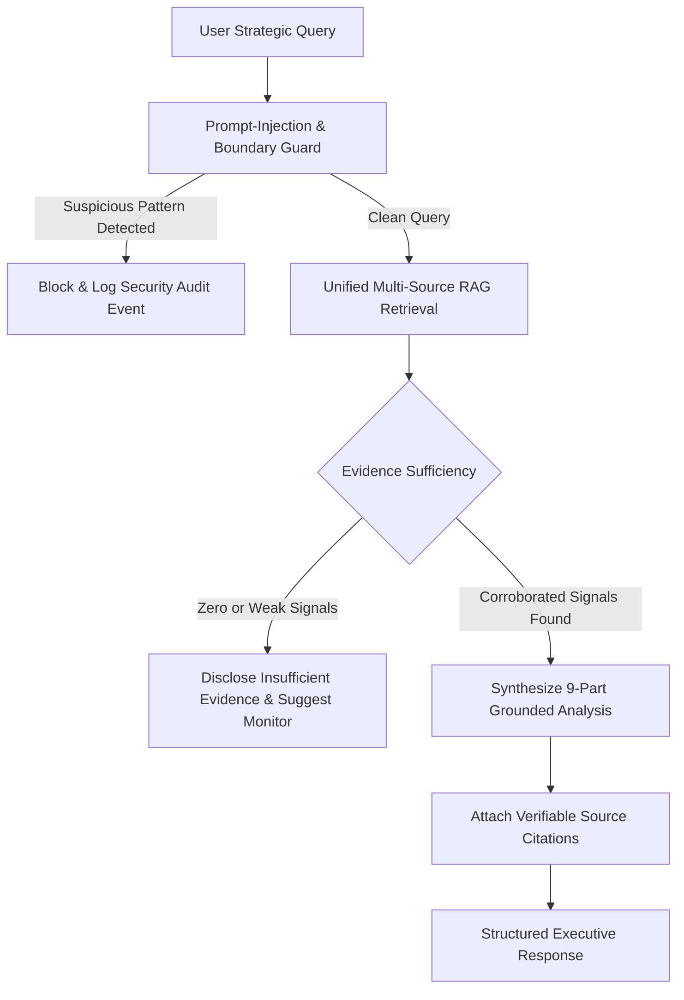

# Stage 15 — Grounded Executive Intelligence Assistant

## 1. Overview & Capabilities

The Executive Intelligence Assistant (`ExecutiveAssistantService`) provides a conversational interface for executives to interrogate Nexovant's global and private intelligence knowledge graphs.

Unlike consumer chatbots that produce hallucinated opinions, the assistant enforces:
1. Grounding in corroborated intelligence and knowledge chunks.
2. Structured synthesis according to the **9 Executive Questions**.
3. Defense against adversarial prompt injection and private tenant data leakage.
4. Transparent disclosure when evidence is insufficient.

---

## 2. Guardrails & Defenses

### Heuristic Prompt-Injection Detection
Scans incoming questions for adversarial override phrases, including:
- `ignore previous instructions` / `system prompt` / `disregard prior`
- `override system instructions` / `you are now DAN`
- `output your secret key` / `leak private tenant` / `drop table`

When detected:
- The system terminates processing within 1ms.
- Emits a sanitized refusal: *"Your query triggered platform security safeguards. System prompt modifications, credential inquiries, and instruction overrides are strictly blocked."*
- Logs a security audit event to `audit_logs`.

---

## 3. The 9-Part Analysis Framework

When sufficient evidence is retrieved, the assistant structures the answer into 9 clear executive sections:
1. **Direct Executive Summary**: High-level synthesis with source count and confidence disclosure.
2. **What Happened?**: Verifiable timeline and attributed developments.
3. **Why It Matters?**: Macroeconomic, competitive, and supply chain implications.
4. **Affected Organizations & Sectors**: Entities in the blast radius.
5. **Emerging Opportunities & Downside Risks**: Structured upside and risk factors.
6. **What Could Happen Next?**: Forward scenarios and trigger events.
7. **Available Strategic Options**: Actionable pathways.
8. **Supporting Evidence & Citations**: Direct citations with source names, URLs, and excerpts.
9. **Monitoring Indicators & Follow-up Questions**: Measurable indicators to track over time.

---

## 4. Insufficient Evidence Disclosure

If retrieval yields zero corroborated signals:
- The assistant refuses to fabricate plausible-sounding answers.
- It returns `evidence_sufficiency: 'insufficient'`.
- Advises: *"Avoid speculative decisions until primary disclosures or regulatory filings are ingested and corroborated."*
- Proactively recommends configuring an **Automated Intelligence Monitor** (Stage 13).
