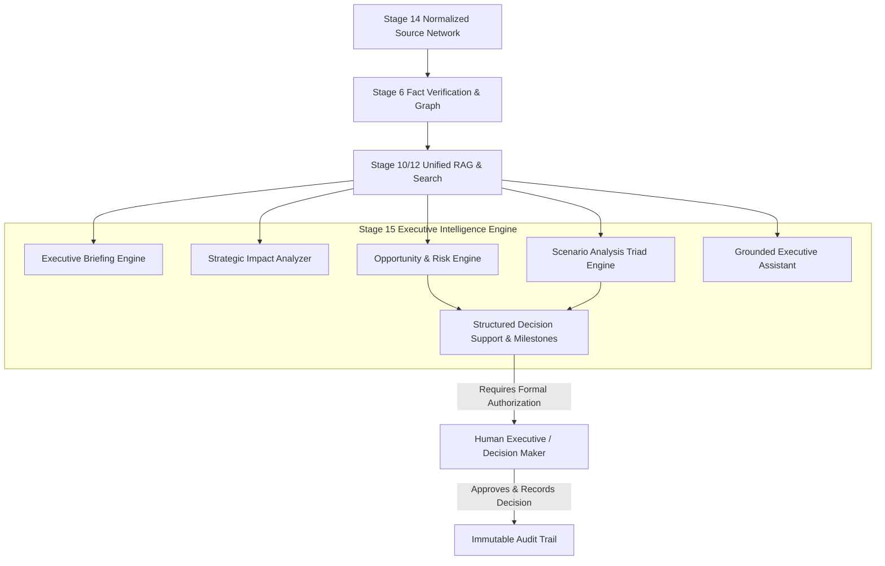

# Stage 15 — Executive Intelligence & Decision Support Architecture

## 1. System Overview

Stage 15 transforms Nexovant into an **Executive Intelligence and Decision Support Platform**, delivering evidence-backed intelligence that addresses the 9 core executive questions:

1. **What happened?** (Verified timeline and event taxonomy)
2. **Why does it matter?** (Strategic significance and macro drivers)
3. **Which organizations, industries, markets or regions could be affected?** (Multi-entity exposure and blast radius)
4. **What opportunities and risks are emerging?** (Structured upside & downside analysis)
5. **What could happen next?** (Trajectory forecasting and scenario triads)
6. **What strategic options are available?** (Actionable choices with trade-offs)
7. **What evidence supports each conclusion?** (Full citation traceability to verified sources)
8. **What decisions should executives consider?** (Actionable decision items requiring human governance)
9. **How should those decisions be monitored over time?** (Observability indicators and milestone tracking)

---

## 2. Architecture & Design Principles

### Core Architectural Invariants:
1. **Strict Human Authorization Policy**: AI assists, structures, and scores, but **never authorizes or binds executive decisions autonomously**. Decisions remain in `pending_approval` status until an authorized executive records their selection.
2. **Evidence-Citation Integrity**: All material assertions are tied to verified sources, articles, or knowledge documents. Synthetic citations are prohibited.
3. **Transparent Uncertainty**: The platform explicitly marks confidence levels (`low`, `medium`, `high`) and uncertainty ratings (`low`, `medium`, `high`, `extreme`), disclosing data origins (public vs tenant-private).
4. **Multi-Tenant Isolation**: Briefings, decisions, milestones, custom scenarios, and private queries are strictly bound to `organization_id`.
5. **Design System v0.1**: Clean editorial styling with `Newsreader` serif headlines, `Inter` interface typography, `#F6F4EF` paper canvas, `#0E1A2B` ink, `#274888` cobalt, and `#B7791F` brass accents.

---

## 3. Subsystem Breakdown

### 3.1 Executive Cockpit (`/executive/dashboard`)
- Consolidated overview of executive intelligence:
  - Top active briefings with review status.
  - Critical strategic impact alerts across 10 dimensions.
  - Active opportunities and escalating risks.
  - Active decision workspaces nearing deadline.
  - Early-warning indicator streams.

### 3.2 Executive Briefing Engine (`/executive/briefings`)
- Generates 7-section structured briefings (`ExecutiveBriefingService`):
  - Executive Summary.
  - What Happened (chronological events with source citations).
  - Why It Matters (geopolitical, macroeconomic, supply chain, regulatory).
  - What Has Changed (comparative trajectory).
  - What Could Happen Next (scenario outlook).
  - Executive Considerations (actionable options & needed information).
  - Evidence & Sources (verified citations).
- Version control (`executive_briefing_versions`), human review approvals, and markdown/JSON export.

### 3.3 Strategic Impact Analyzer (`/executive/strategic-impact`)
- Evaluates 10 core dimensions: `geopolitical`, `macroeconomic`, `regulatory`, `supply_chain`, `financial_liquidity`, `competitive_landscape`, `technological_disruption`, `reputational`, `operational`, `cyber_physical_security`.
- Tracks potential direction (`positive`, `negative`, `neutral`, `bifurcated`), magnitude (`low`, `moderate`, `severe`, `transformative`), and time horizon.
- Highlights supporting vs contradictory evidence and explicit assumptions.

### 3.4 Opportunity & Risk Intelligence (`/executive/opportunities-risks`)
- 9 opportunity categories & 9 risk categories.
- Transparent likelihood scoring, severity classification, confidence rating, and monitoring indicators.
- Workflow transitions (`detected` → `evaluating` → `pursuing` / `mitigating` → `resolved`).

### 3.5 Scenario Analysis Engine (`/executive/scenarios`)
- Automated generation of scenario triads: **Optimistic**, **Baseline**, and **Adverse**.
- Side-by-side comparative matrix across assumptions, trigger events, and consequences.
- Scenario branching (duplication) and archiving.

### 3.6 Structured Decision Support (`/executive/decisions`)
- End-to-end 10-step decision governance:
  1. Business question & objective definition.
  2. Background context & current intelligence.
  3. Strategic options trade-off matrix (advantages, disadvantages, risks, scores).
  4. Weighted evaluation criteria.
  5. Human executive authorization modal with permanent audit record.
  6. Observable execution milestones with status tracking (`pending`, `in_progress`, `completed`, `delayed`).
  7. Multi-party review log and retrospective analysis.

### 3.7 Executive Intelligence Assistant (`/executive/assistant`)
- Grounded Q&A interface enforcing prompt injection defense and the 9 Executive Questions structure.
- Discloses source consultation count, evidence citations, and confidence levels.
