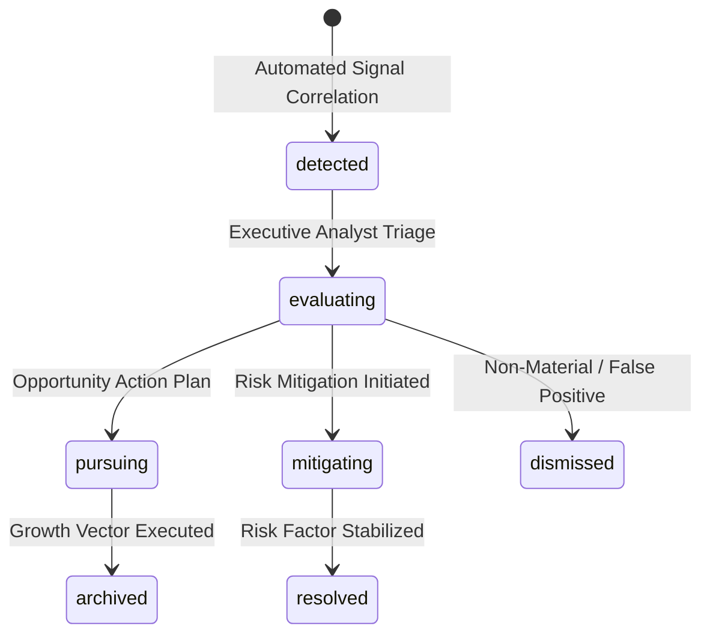

# Stage 15 — Opportunity & Risk Intelligence Engine

## 1. Overview & Taxonomy

The Opportunity & Risk Intelligence subsystem continuously monitors ingested signals and intelligence reports to detect emerging business opportunities and critical operational risks.

---

## 2. Taxonomy Breakdown

### Strategic Opportunities (9 Categories):
1. `emerging_markets`: Untapped geographic or demographic demand sectors.
2. `new_technologies`: Novel computing architectures, packaging, or algorithms.
3. `industry_expansion`: Policy tailwinds (e.g. EU/US CHIPS Acts, green subsidies).
4. `competitor_weaknesses`: Competitor supply delays, executive turmoil, or product recalls.
5. `regulatory_openings`: Deregulation or specialized procurement fast-tracks.
6. `supply_chain_alternatives`: New domestic suppliers or near-shoring corridors.
7. `strategic_partnerships`: Consortium alliances, co-development opportunities.
8. `cost_reduction`: Input commodity deflation or automation efficiencies.
9. `talent_acquisition`: Industry consolidation releasing elite engineering teams.

### Priority Downside Risks (9 Categories):
1. `geopolitical_tensions`: Border embargoes, cross-border export license bans.
2. `supply_chain_bottlenecks`: Single-foundry bottlenecks, critical mineral quotas.
3. `regulatory_scrutiny`: Antitrust inquiries, mandatory compliance audits.
4. `macroeconomic_pressures`: Inflationary input spikes, FX devaluation.
5. `competitive_disruption`: Radical pricing cuts or surprise competitor announcements.
6. `cyber_incidents`: Ransomware strikes against tier-1 suppliers.
7. `reputational_damage`: Public backlashes regarding ESG or compliance.
8. `operational_failures`: Facility qualification failures, yield crashes.
9. `legal_disputes`: Patent infringement injunctions, class-action lawsuits.

---

## 3. Likelihood & Scoring Guardrails

```
Likelihood Score: 0% – 100%
Severity Scale: Low | Medium | High | Critical
Confidence Rating: Low | Medium | High
```

### Transparent Likelihood Notice:
To prevent executive users from misinterpreting AI scores as rigorous statistical actuarial models, the UI and API explicitly display:
> *"Note: Likelihood scores represent transparent heuristic analyst estimations based on signal corroboration, not statistically calibrated probabilities."*

---

## 4. Lifecycle & Status Transition Matrix



All status changes are permanently logged to the organization audit log with timestamps, user ID, and justification notes.
