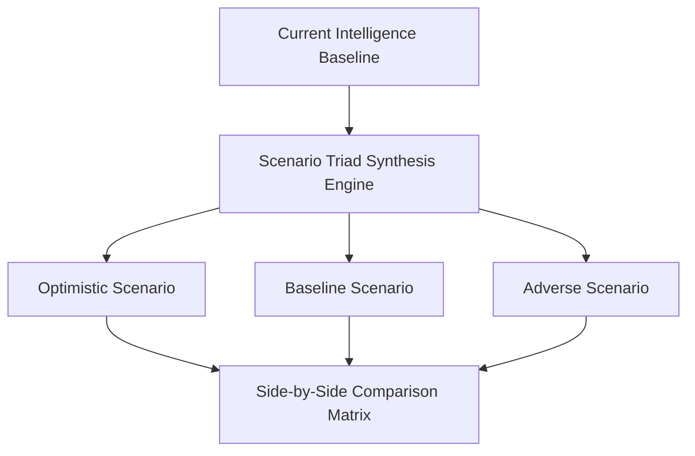

# Stage 15 — Scenario Analysis Engine

## 1. Overview & Objectives

Strategic forecasting in high-uncertainty environments cannot rely on linear projections. The Stage 15 Scenario Analysis Engine models dynamic future states grounded in verified current intelligence.

The engine automates the generation of structured **Scenario Triads** (`optimistic`, `baseline`, `adverse`), identifies explicit trigger conditions, tracks sensitivities, and enables side-by-side comparative matrix evaluations.

---

## 2. Scenario Triad Architecture

When an executive provides a strategic subject (e.g., *"Global Semiconductor Subsidies & Supply Chain Re-shoring 2026-2028"*), the engine synthesizes three synchronized branches:

### 1. Optimistic Scenario
- Model path where catalysts accelerate, regulatory approvals proceed smoothly, and market demand expands.
- Focuses on upside capture, early-mover advantages, and margin expansion.
- Discloses prerequisite assumptions and risks of overestimating market capacity.

### 2. Baseline Scenario
- Most probable outcome based on historical precedents and current macro trends.
- Accounts for standard regulatory timelines, seasonal fluctuations, and scheduled capex deployments.
- Serves as the operational anchor for quarterly budgeting and milestones.

### 3. Adverse Scenario
- Stress-test branch modeling cascading friction, geopolitical escalation, tariff retaliation, or supply freezes.
- Identifies critical failure modes, margin compression vectors, and immediate defensive actions.

---

## 3. Core Scenario Fields & Metadata

Each scenario contains:
- `subject`: The strategic topic or policy question.
- `scenario_type`: `optimistic`, `baseline`, `adverse`, or `alternative`.
- `description`: Narrative logical flow of developments.
- `initial_conditions`: Grounding baseline state.
- `key_assumptions`: Explicit requirements for this branch to hold.
- `trigger_events`: Observable external developments signaling transition into this branch.
- `opportunities` & `risks`: Specific upside vectors and failure modes.
- `indicators_to_monitor`: Measurable telemetry metrics (e.g. quarterly port throughput, capex filings).
- `uncertainty_rating`: `low`, `medium`, `high`, `extreme`.
- `is_custom`: Flag distinguishing user-authored or branched scenarios from automated AI generations.

---

## 4. Side-by-Side Matrix Comparison

The matrix allows executives to compare up to 4 scenarios simultaneously across:
- Core Narrative and development trajectory.
- Horizon and Uncertainty ratings.
- Sensitivity Triggers.
- Emerging Opportunities vs Downside Risks.
- Early-Warning Telemetry Indicators.
